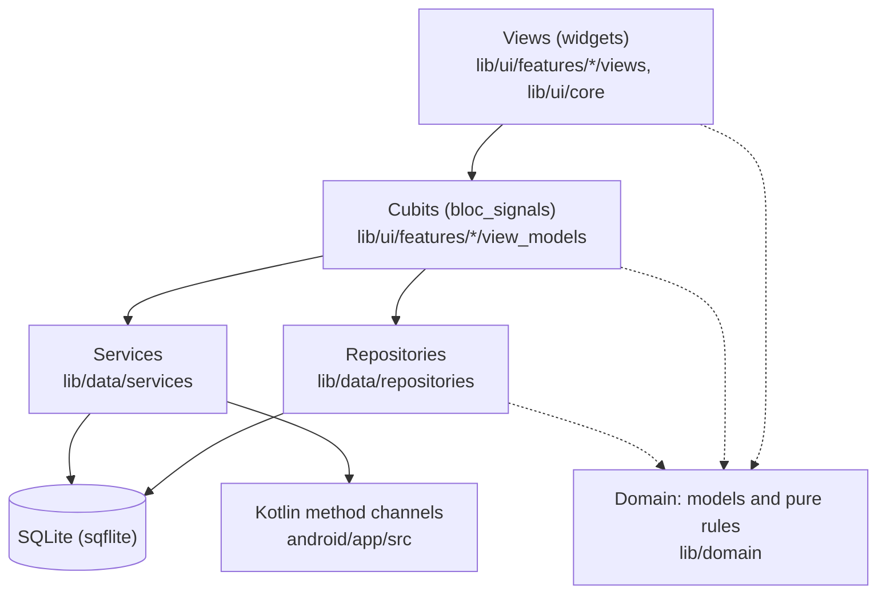
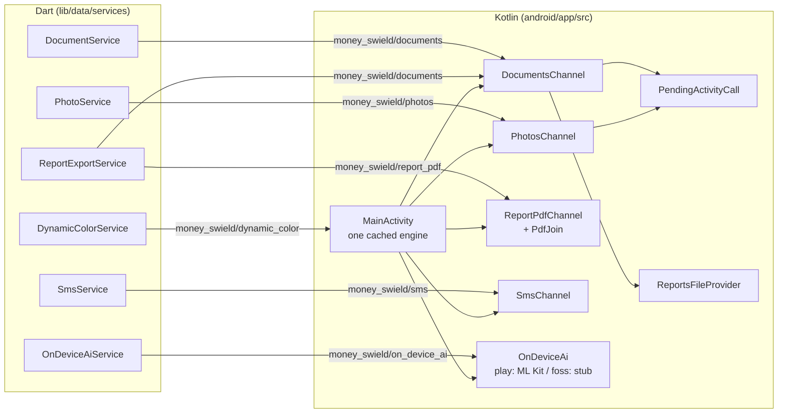

# AGENTS.md

Guide for AI agents (and people) working on this repo. Read it before
changing code.

## The app

**Money Swield**, an offline expense tracker for **Android only** (Flutter). It answers
"where did my money go?" by week, month, year, category and event.

- Recording an expense takes seconds: title, amount, category, Save.
- The data is never lost or corrupted. Everything stays on the phone: no
  server, no account, no sync.

Tabs: **Home** (trend card, filters, grouped expense list), **Reports**
(charts, PDF / Excel export), **Manage** (categories, events, payment
methods, recurring items), **Settings** (language, look, backup & restore,
bin, photos, SMS).

### Out of scope (on purpose)

- Budgets, account balances, income.
- Currency conversion. Totals are kept per currency and never added across
  currencies.
- Refunds or negative amounts.
- iOS, web, desktop.
- Cloud sync, accounts, any server, analytics.
- Background services. The SMS scan runs only while the app is open.
- A router package or deep links: plain `Navigator` push / pop.
- Code generation (no freezed, json_serializable, build_runner).
- Closed-source Dart packages, or packages that pull in Google Play
  Services or Firebase.

### Licence

GPL-3.0-or-later (`LICENSE`), with one exception in `README.md`: builds
may include Google ML Kit (`play` flavor only). The name and logo are not
under the GPL (`TRADEMARKS.md`). A new dependency must have a GPL-3.0-compatible
licence (MIT, BSD, Apache-2.0, …).

## Ground rules

1. **Never lose or corrupt user data.** Every multi-row write is one
   transaction. A delete goes to the bin first. Ask before anything that
   could drop data or can't be undone.
2. **Keep it plain.** Simple, readable code over clever code. A little
   duplication is fine when it keeps things clear.
3. **Explain deliberate choices in a comment.** Say *why*, so a reviewer
   doesn't "fix" it. A product decision made by the owner is marked
   `(owner, YYYY-MM-DD)`; keep those markers.
4. **No real personal data** in code, tests or docs: no real SMS, bank,
   payee, amount, card or place. Use made-up values.
5. **Comments describe the code, not a document.** Don't reference
   planning docs, phases or ticket numbers in comments.
6. **Don't commit** unless asked. No AI attribution lines in commits or
   PRs.

## Skills (load before writing code)

- `dart-flutter` plugin skills, for any Dart or Flutter work.
- `bloc-signals:bloc-signals`, for any cubit, provider, builder or
  listener. This app uses `bloc_signals`, **not** `package:bloc`: the API
  differs (`CubitSignal`, synchronous state, signal-based builders).

**Stale skills.** A plugin's skills can change without its version being
bumped, and then an update keeps the old cached copy. Before relying on a
skill, check it is current: compare the `gitCommitSha` of the plugin in
`~/.claude/plugins/installed_plugins.json` with the marketplace's latest
commit. If they differ, refresh the marketplace and reinstall the plugin
(uninstall, then install). Also check the skill against the package
version in `pubspec.lock`; when a skill and the package disagree, the
package's own source wins.

## Commands

Everything goes through `make` (bash on every OS). `make help` lists the
targets.

| Task | Command |
|---|---|
| Get packages | `flutter pub get` |
| Format | `make format FILES="lib/a.dart test/a_test.dart"` |
| Analyze | `make analyze` (must be clean: no errors, warnings or infos) |
| Test one file | `flutter test --timeout 120s test/path/to_test.dart` |
| Full test run | `make test` (builds two suite files with `tool/test_suites.dart`) |
| Kotlin unit tests | `make test-android` (JVM, both flavors) |
| Build APK | `make build MODE=debug\|release FLAVOR=foss\|play` |
| Google Play upload | `make bundle`: the play AAB (`NO_SMS=1` leaves READ_SMS out) |
| GitHub upload | `make github`: foss + play release APKs split per ABI, 6 in `build/dist/` |
| F-Droid check | `make fdroid`: foss release APKs split per ABI, 3 in `build/dist/` |
| Install on phone | `make install` / `make reinstall` (reinstall wipes data) |
| New migration | `make migration NAME=add_something` |
| Outdated dependencies | `make check-dep`: `flutter pub outdated`, then the Gradle wrapper, plugins and Kotlin libraries (Gradle Versions Plugin, added by `tool/check_dep.init.gradle.kts` for that run only) |
| Regenerate strings | `flutter gen-l10n` (also runs on build) |

- **Format at width 80.** The width is pinned in `analysis_options.yaml`;
  never pass another one. Format only the files you touched.
- **Run the related tests**, not the whole suite, while working. One file
  at a time, with `--timeout`: a hung widget test otherwise blocks for
  minutes.
- Tests compile Android 10's SQLite from `third_party/sqlite_android_10/`
  on the first run. That needs Visual Studio's C++ build tools (MSVC) on
  Windows.
- `SMS_LOOKBACK_DAYS=n` (debug builds only) widens the SMS scan window for
  a test phone whose messages are old.

## Architecture

Flutter's layered architecture. Dependencies point down only.



- **UI → Cubit → Repository → Database.** Widgets never call a
  repository or run SQL. Repositories never import widgets.
- **Repositories are the only code that runs SQL.** One per aggregate.
- **Rules live in `lib/domain/` as pure Dart** (no Flutter, no I/O), so
  they are unit tested without widgets.
- **`AppDependencies`** (`lib/app/app_dependencies.dart`) builds every
  repository and service once the database is open, and hands them to the
  widget tree. No service locator.
- **Money** is `Money` (`amountMinor` int + `currencyCode`), never a
  `double`. Formatting goes through `MoneyFormatter` with the current
  locale.
- Models are plain immutable Dart classes with `copyWith`.

### File structure

```
lib/
  main.dart            starts migrations, then runApp
  app/                 App, shell (NavigationBar), startup gate and cubit,
                       AppDependencies, flavor, restart after restore
  domain/              pure rules: amounts and expressions, periods, trend,
                       recurrence, reports, photos, title suggestions
    models/            immutable data classes (Expense, Money, …)
    sms/               SMS pre-filter, regex parser, learning, AI prompt
  data/
    repositories/      all SQL, one class per aggregate
    services/
      database/        AppDatabase, migration framework, migrations/
      backup/          backup zip, manifest, paths, pre-restore copies
      xlsx/            own .xlsx writer
      *_service.dart   platform wrappers over the Kotlin channels
  ui/
    core/              shared widgets, charts, formatters, themes, pickers
    features/<name>/
      view_models/     cubits
      views/           screens and their widgets
  l10n/                ARB files (en template, es, hi) + generated code
test/                  mirrors lib/; helpers/ has fakes and test databases
tool/                  new_migration.dart, test_suites.dart
android/app/src/
  main/                manifest, Kotlin channels shared by both flavors
  foss/, play/         flavor manifests and the OnDeviceAi class
  playNoSms/           play manifest without READ_SMS
  test/                JVM unit tests of the plain Kotlin parts
third_party/           Android 10's SQLite source, for tests only
fastlane/metadata/android/en-US/
                       F-Droid store listing: title, descriptions,
                       changelogs/<versionCode>.txt (one per ABI),
                       icon, feature graphic, phone screenshots
```

### Startup

1. `main()` reads the wallpaper colour and starts `MigrationCubit`. The
   migration screen shows only while migrations run; each run backs the
   database up first.
2. `StartupCubit` (shown by `StartupGate`) opens `AppDependencies` and
   loads settings. If that fails, the error screen offers Retry, and
   **Undo last restore** when a pre-restore copy exists.
3. Then, in order, each step logged and never blocking start: recurring
   payments that came due (also on resume and at midnight; a
   backlog older than 31 days is held for the user to review), bin purge
   (30 days), SMS suggestion purge (30 days), leftover backup / restore
   files, old report files, photo sweep.
4. Onboarding if not done, else Home.
5. SMS scan after the first frame, and again on resume (at most once a
   minute), if the user turned it on and granted the permission.

### Flavors

| | `foss` (default) | `play` |
|---|---|---|
| Store | F-Droid, GitHub | Google Play (AAB), GitHub |
| App id | `com.skj.money.swield.expense.tracker.foss` | `com.skj.money.swield.expense.tracker.play` |
| Launcher name | Money Swield (FOSS) | Money Swield |
| SMS suggestions | yes | yes; `-PnoSms=true` removes READ_SMS |
| SMS parsing | regex | on-device AI (ML Kit GenAI, Gemini Nano) if available and on, else regex |
| Closed-source code | **none** | ML Kit GenAI Prompt (`playImplementation` only) |

`pubspec.yaml` can't have per-flavor dependencies, so closed-source code
lives only in `android/app/src/play/` with its library added as
`playImplementation`. `src/foss/` has a stub class with the same name that
answers "unavailable". Dart reads the flavor with `currentAppFlavor`;
anything but `play` is foss. `android/app/proguard-play.pro` keeps ML
Kit's reflection-loaded classes in play release builds.

**Debug builds are separate apps**: the `debug` build type adds `.debug`
to the id (`….foss.debug`, `….play.debug`) and " (debug)" to the
launcher name, so a debug install never touches the data of a released
app on the same phone. The Kotlin package (`namespace`) is the base id
without a suffix; the Dart package is `money_swield`.

**Releases** (`version:` in `pubspec.yaml`; split APKs get 1000 × ABI
number added to the version code by Flutter):

| Where | What | Command |
|---|---|---|
| Google Play | play AAB | `make bundle` |
| GitHub | foss + play, one APK per ABI (armeabi-v7a, arm64-v8a, x86_64): 6 | `make github` |
| F-Droid | foss, one APK per ABI: 3 | built by F-Droid from source (recipe in fdroiddata, one build entry per ABI); `make fdroid` builds the same locally |

**Signing**: release builds read `android/key.properties` (`storeFile`,
`storePassword`, `keyAlias`, `keyPassword`; `storeFile` relative to
`android/`). The file and the keystore are gitignored and never
committed. Without the file, release builds fall back to the debug key
(for `flutter run --release` and F-Droid, which signs with its own key);
`make bundle` and `make github` refuse to run without it.

## Kotlin side

No Flutter plugins for platform work: small own Kotlin classes, one
`MethodChannel` each, created in `MainActivity` on one cached
`FlutterEngine`.



| Class | Does |
|---|---|
| `MainActivity` | Keeps **one Flutter engine per process** in `FlutterEngineCache`. A recreated activity reattaches to the same Dart isolate, so a migration is never run twice or left holding the database lock. Forwards activity results and permission answers. Answers `accentColor` (wallpaper colour, Android 12+). |
| `DocumentsChannel` | App version; the system save / open dialogs (backups); Save to `Download/<App>/` through MediaStore; Share; open a saved file. |
| `PhotosChannel` | Camera and photo picker; reads, previews, resizes and re-encodes pictures off the main thread; Save to `Pictures/<App>/` through MediaStore; free space. |
| `ReportPdfChannel` | Draws a report with Android's `PdfDocument` (system text shaping, so Hindi and emoji are right), in parts of 100 pages; `PdfJoin` joins the parts so memory stays bounded. |
| `SmsChannel` | READ_SMS status and request, app settings page, reads the inbox from a time. |
| `OnDeviceAi` | play: ML Kit GenAI Prompt API (status, model download, prompt). foss: stub, always `unavailable`. `OnDeviceAiCodes` maps ML Kit's numbers to the words Dart sees. |
| `PendingActivityCall` | One activity-for-result call at a time, surviving activity recreation. |
| `CallAnswer` | Runs background work and turns failures (incl. `OutOfMemoryError`) into channel error codes. |
| `ReportsFileProvider` | A second `FileProvider` that shares `cache/reports/` only. |

No storage permissions anywhere: the app's files are in its own storage,
and MediaStore writes to Pictures / Download need none on Android 10+.

## Database

SQLite through `sqflite`. Schema in
`lib/data/services/database/migrations/`; how to write one:
`lib/data/services/database/migrations/README.md`.

- **Money**: `INTEGER` minor units (`amount_minor`) with a `currency_code`
  next to it. Never a float. Two currencies are never summed.
- **Timestamps**: epoch milliseconds, UTC. **Calendar dates**: `TEXT`
  `YYYY-MM-DD` in the user's local calendar when recorded.
- Booleans are `0` / `1`.
- No `CHECK`, triggers, views or generated columns: the migration
  framework refuses to rebuild tables that have them. Validation is in
  Dart.
- Built-in rows have a `builtin_key` and a NULL `name` until renamed; the
  shown name is `name ?? translation(builtin_key)`.
- Case-insensitive name checks are done in Dart, not with `UNIQUE`.
- Foreign keys are on. Category and payment method: `RESTRICT` (the app
  moves expenses first). Join tables: `CASCADE`. Recurring item:
  `SET NULL`.
- Photo files are named by their SHA-256; only the startup sweep deletes
  photo rows and files.
- **Migrations**: until the first release, edit the existing migration
  instead of adding one (old dev databases need a fresh install). After
  release, never edit a released migration: add a new one.

### SQL must run on SQLite 3.22 (Android 10, `minSdk 29`)

Tests run on that exact build (`pubspec.yaml` `hooks:` compiles
`third_party/sqlite_android_10/sqlite3.c`;
`sqlite_engine_test.dart` guards it).

- Not available: `TRUE` / `FALSE`, UPSERT, window functions,
  `RENAME COLUMN` / `DROP COLUMN`, `NULLS FIRST/LAST`, `FILTER`, `iif()`,
  `UPDATE … FROM`, `RETURNING`, `STRICT`, JSON functions, `unixepoch()`,
  `RIGHT` / `FULL JOIN`, `concat()`, `sqlite_schema` (use
  `sqlite_master`).
- At most 999 bound variables per statement: chunk at 500.
- **Case folding differs**: tests fold ASCII only, phones fold Unicode
  (ICU). Never compare user text case-insensitively in SQL; do it in Dart.
- `"x"` silently becomes the text `x` when no column `x` exists. Text in
  single quotes; check every query's result, not just that it ran.
- `INSERT OR REPLACE` deletes the old row first (cascades): use it only on
  tables nothing references. Never use the result of `INSERT OR IGNORE`
  (0 in tests, −1 on a phone). `OR IGNORE` doesn't skip a foreign key
  failure.
- Inside `transaction()`, read through the transaction, never the
  database: the database read waits forever.
- Many rows over the channel are slow: batch writes, and read thousands of
  small values as one `group_concat`.
- Unknown `PRAGMA`s do nothing and raise no error.

## Design decisions

| Topic | Decision |
|---|---|
| Default currency | Changes the default for **new** expenses only. Quick switch from Home's currency chip. |
| Mixed currencies | A separate total per currency. Charts show one currency; swipe sideways for the others. |
| Expense form | Title first, then amount. Title suggestions prefill only fields the user hasn't touched, from the latest expense with that exact title. |
| Amount field | Expressions with `+ − × ÷`, normal precedence, no brackets. Rounded once, at the end, half-up to the currency's minor unit. |
| Unsaved form | One draft slot, kept in memory and mirrored to the database. Back keeps it, no "discard?" prompt. Save, Update and Delete clear it in the same transaction. |
| Category / events | Exactly one category, zero or more events. Old events can be archived (hidden from pickers, still in reports). |
| Deleting an expense | Goes to the bin with its photos, with Undo; purged after 30 days. Deletes inside the bin ask first. |
| Deleting a used category or payment method | Ask where to move its expenses, then delete. |
| Photos | Up to 10 per expense, in the app's own storage, never in the gallery. Save to Pictures makes the user's own copies, which the app never touches again. |
| Backup / restore | A zip, with or without photos. Restore replaces all data (no merge); the current database is kept as a pre-restore copy first, and can be put back. |
| Recurring | Payments are added on their due date when the app opens or resumes. A backlog older than a month is asked first. A price change applies from a date and never edits past expenses. Changing how often makes a new item and archives the old one. Deleting a payment skips it for good. |
| SMS suggestions | Opt-in. Indian bank debit SMS only, not ATM withdrawals. Scanned when the app opens, never in the background. **The SMS text is never stored** (only amount, payee, method, time, reference, and a hash). No match means ignored: never guessed. |
| On-device AI (play) | Only a debit whose amount appears in the SMS text is accepted; anything else falls back to the regex, so no SMS is lost to the AI. Runs only in the foreground; the model is downloaded only when the user asks. |
| Reports | Exports to PDF (Android's `PdfDocument`) or Excel (own writer). Saved to Download through MediaStore, no permission. |
| Strings | Every user-visible string comes from ARB (en, es, hi). Dates, numbers and money use `intl` with the active locale. |
| Themes | Material 3, seeded from the wallpaper (Android 12+), a picked colour, or a default. |

## Testing

- Write tests to **find bugs**, not to pass. Every bug fixed gets a
  regression test that fails without the fix.
- Domain rules: unit tests. Repositories: real SQLite 3.22 (in memory or
  on files under `.dart_tool/test_tmp`, see `test/helpers/`). Cubits: unit
  tests with fakes. Flows: widget tests on a 360 dp wide screen, where an
  overflow fails the test.
- Edge cases worth covering: en / es / hi (`,` decimal separator),
  currencies with 0 and 3 decimals, time zones, binned and future-dated
  rows, empty and maximum-length input, double taps, the app killed
  between two writes, a restore swapping the database.
- A migration needs an `up → down → up` test (`all_migrations_test.dart`
  checks every registered one).
- Throwaway probe tests go in `test/zz_tmp/` and are deleted afterwards.
- Plain Kotlin logic is JVM-tested in `android/app/src/test/`.
- A UI change is done only after it is built, installed and checked on a
  real phone (not an emulator). Test phones are 360 dp and 411 dp wide.

## Good to know

- `MainActivity`'s single cached engine means back-then-reopen returns to
  where the app was instead of restarting it. That is intended.
- Text that can be very long (titles, names) must never overflow at the
  largest font size; layouts stack or wrap instead.
- Lint rule `document_ignores` is on: every `// ignore:` needs a comment
  line above it saying why.
- SMS test fixtures in `test/domain/sms/fixtures/` are anonymized samples;
  a new bank format means a new regex plus a new made-up fixture.
- Windows dev machine: use the Edit tool or a Python script for multi-line
  edits; bash heredocs can mangle `$`, `\'` and non-ASCII text.
