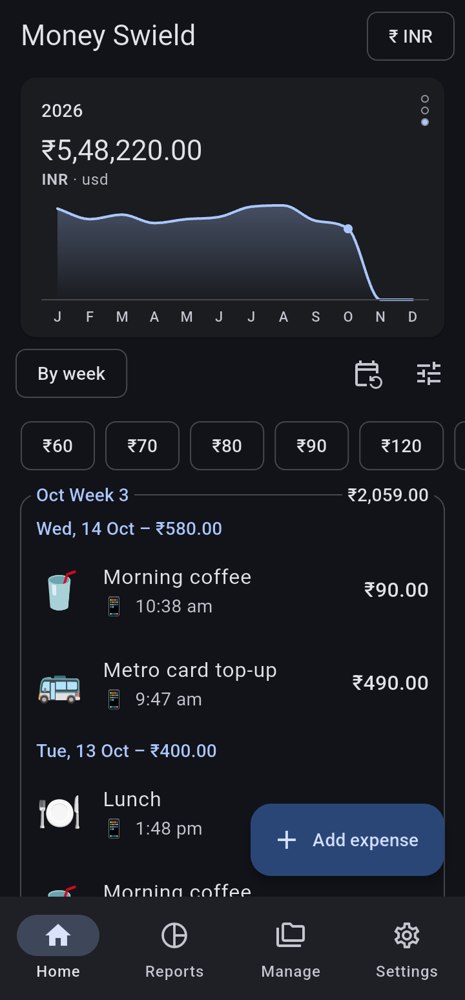
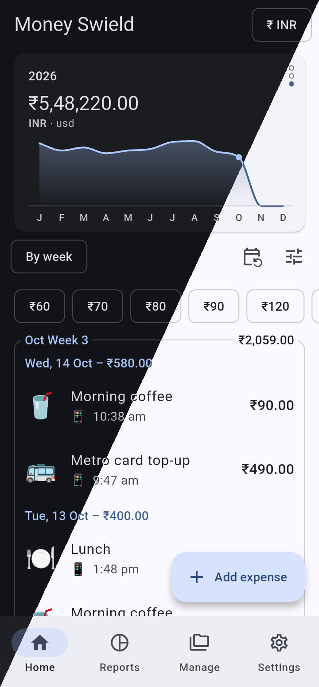
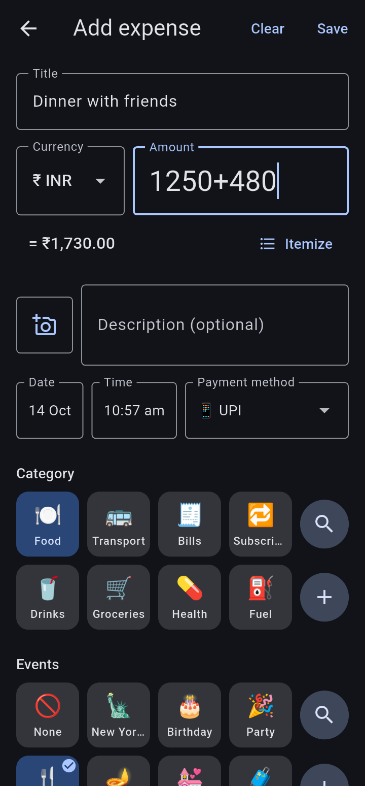
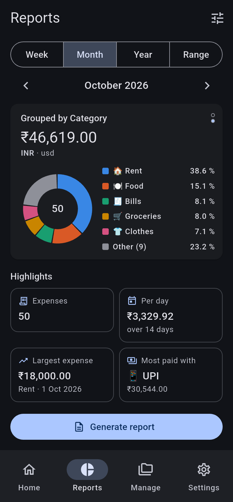
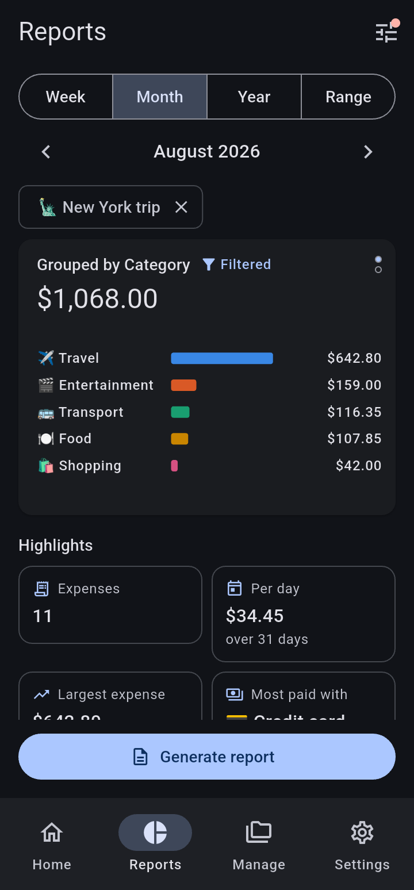
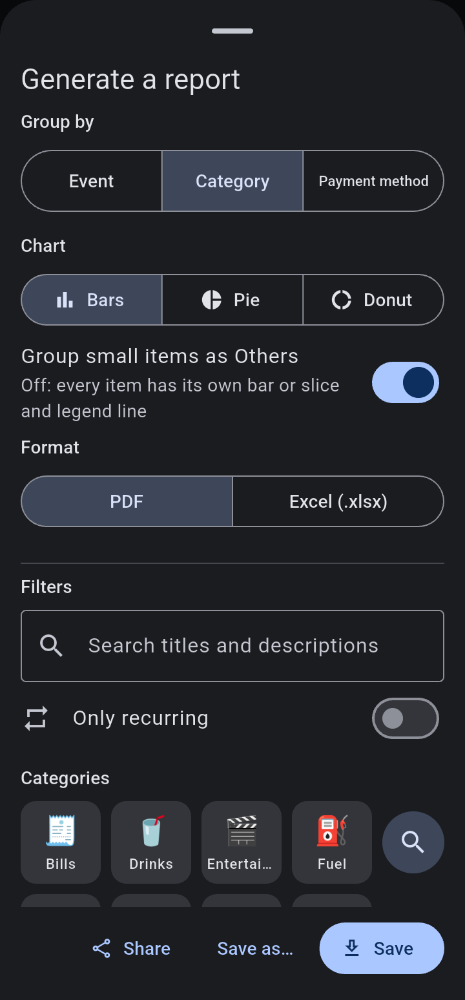
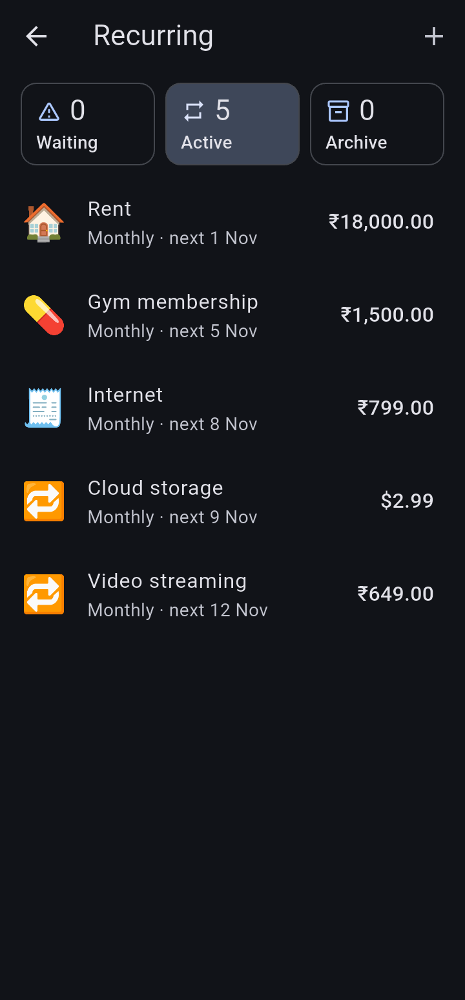
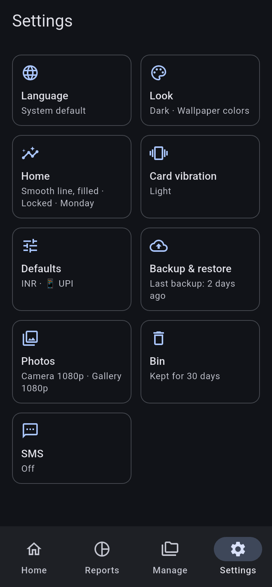

# Money Swield

An offline expense tracker for Android, built with Flutter. It answers one
question: **where did my money go?** See it by week, month, year, category or
event. Everything stays on your phone: no account, no server, no sync, no ads
and no tracking. The app has no internet permission at all.

## Download

<table>
  <tr>
    <th>Obtainium: FOSS</th>
    <th>Obtainium: Play</th>
    <th>Komi Store</th>
  </tr>
  <tr>
    <td><a href="https://apps.obtainium.imranr.dev/redirect?r=obtainium://app/%7B%22id%22%3A%22com.skj.money.swield.expense.tracker.foss%22%2C%22url%22%3A%22https%3A%2F%2Fgithub.com%2Fskj-skj%2FMoney-Swield%22%2C%22author%22%3A%22skj-skj%22%2C%22name%22%3A%22Money%20Swield%20%28FOSS%29%22%2C%22additionalSettings%22%3A%22%7B%5C%22apkFilterRegEx%5C%22%3A%5C%22-foss-%5C%22%7D%22%7D"></a></td>
    <td><a href="https://apps.obtainium.imranr.dev/redirect?r=obtainium://app/%7B%22id%22%3A%22com.skj.money.swield.expense.tracker.play%22%2C%22url%22%3A%22https%3A%2F%2Fgithub.com%2Fskj-skj%2FMoney-Swield%22%2C%22author%22%3A%22skj-skj%22%2C%22name%22%3A%22Money%20Swield%22%2C%22additionalSettings%22%3A%22%7B%5C%22apkFilterRegEx%5C%22%3A%5C%22-play-%5C%22%7D%22%7D"></a></td>
    <td><a href="https://komistore.app/app/?repo=skj-skj/Money-Swield"></a></td>
  </tr>
</table>

Or download an APK from [GitHub Releases](https://github.com/skj-skj/Money-Swield/releases/latest).
Pick `foss` (no closed-source code) or `play` (adds on-device AI for SMS
parsing), and your phone's ABI (`arm64-v8a` for most phones).

### Coming soon


## Screenshots

<p>
  
  
  
  
</p>
<p>
  
  
  
  
</p>

## Features

- **Quick entry.** Title, amount, category, Save. Type a title you've used
  before and the rest is filled in for you. Leave the form at any time; your
  draft is kept.
- **Amount chips.** Home shows chips with your usual amounts; tap one to start
  an expense with that amount.
- **Math and itemize.** Type `120 + 85 × 2` in the amount field. Itemize then
  asks what each part of the sum was and lists the items in the note.
- **Categories and events.** Every expense has one category and any number of
  events (a trip, a wedding, a festival). Old events can be archived. Add your
  own payment methods too.
- **Photos.** Up to 10 photos per expense (receipts, bills), kept inside the
  app, never in your gallery. Browse every photo of the expenses on Home and
  tap one to open its expense.
- **Filters.** Filter by category, event, recurring or text, and group the
  list by day, week, month or year. A trend card shows this week's, month's
  or year's total.
- **Reports.** Charts and highlights by period, category or event, exported
  to PDF or Excel.
- **Recurring payments.** Rent, subscriptions and bills are added on their due
  date. Change a price from a given date without touching past expenses, or
  skip a payment.
- **SMS suggestions (optional).** Turn it on and the app reads debit SMS from
  Indian banks while it is open, and suggests them as expenses. The SMS text is
  never stored and never leaves your phone. It never runs in the background.
  The `play` build can use on-device AI (Gemini Nano) to read them.
- **Many currencies, kept apart.** Each currency keeps its own total; amounts
  are never converted or added across currencies.
- **Backup and restore.** One zip file, with or without photos, that you can
  restore on any phone. A restore can be undone. Deleted expenses go to a bin
  for 30 days, with Undo.
- **Make it yours.** Light or dark theme, colours from your wallpaper or one
  you pick. English, Spanish and Hindi.

## Development

The data is stored in a SQLite database in the app's package directory,
`/sdcard/Android/data/<package-name>/` (app-specific external storage; Android
deletes it when the app is uninstalled).

### Getting started

```sh
flutter pub get
flutter run
```

### Building from source

You need Flutter (the version the Release workflow uses, in
`.github/workflows/release.yml`), the Android SDK and `make` (bash on every
OS; on Windows, Git Bash works). `make help` lists every target.

There are two flavors:

- `foss`: fully open source. SMS suggestions use the regex parser.
- `play`: adds Google's closed-source ML Kit, so SMS suggestions can use
  on-device AI (Gemini Nano) on phones that support it.

```sh
flutter pub get

# One APK for all ABIs. MODE is debug (default) or release; FLAVOR is foss
# (default) or play.
make build MODE=release FLAVOR=foss
make build MODE=release FLAVOR=play

# Install the built APK on a phone over adb (same MODE and FLAVOR).
make install MODE=release FLAVOR=foss
```

The APK is written to `build/app/outputs/flutter-apk/app-<flavor>-<mode>.apk`.
Debug builds get a separate app id (`….debug`), so they install next to a
released app without touching its data.

Release builds are signed with the key in `android/key.properties`; without
that file they fall back to the debug key, which is fine for your own phone.
`make github` (foss + play APKs split per ABI, in `build/dist/`) and
`make bundle` (the play AAB) need the key and refuse to run without it.

### Running the tests

```sh
flutter test
```

Run a single file or folder by passing its path:

```sh
flutter test test/data/services/database/migration/migrator_test.dart
flutter test test/data/services/database/
```

The database tests use a real SQLite engine (through `sqflite_common_ffi`), so
they run on your development machine without a phone or emulator.

### Database migrations

The database schema is changed only through Rails-style migrations. Pending
migrations run when the app starts, behind a progress screen, after the
database has been backed up.

Create a new migration from the project root:

```sh
dart tool/new_migration.dart add_currency_to_expenses
```

This creates
`lib/data/services/database/migrations/<unix time>_add_currency_to_expenses.dart`
and registers it in `all_migrations.dart`. Fill in its `up` and `down` methods,
then run `flutter test`. The test suite checks that every migration is
registered and can run `up -> down -> up`.

Never edit or delete a migration that has already been released; write a new
one instead.

**Before writing a migration, read the
[database migrations guide](lib/data/services/database/migrations/README.md)**.
It lists every available operation, explains how to backfill data, and describes
how user data is protected.

## License

Copyright (C) 2026 skj-skj. Licensed under the
[GNU GPL v3.0 or later](LICENSE), with no warranty.

One exception: the `play` flavor uses Google's closed-source ML Kit, and
you're allowed to share builds that include it (GPL section 7).

The name "Money Swield" and its logo are not covered by the GPL; see
[TRADEMARKS.md](TRADEMARKS.md).
